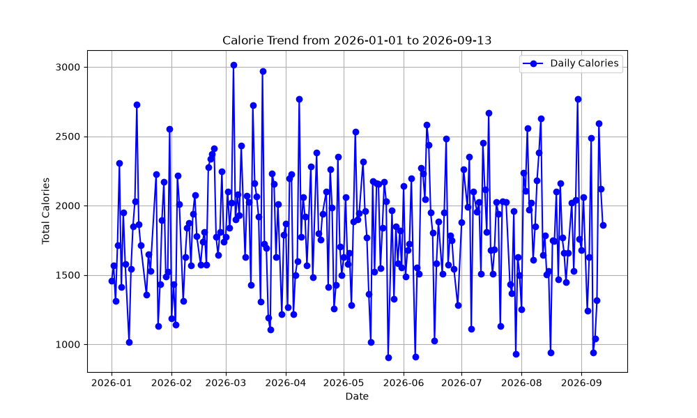

# CalBuddy

CalBuddy is a terminal-based nutrition tracker built with Python and MySQL. It lets users save meals, log servings, review calorie and macronutrient intake, and generate a calorie trend chart.

I built this personal project to practice Python, relational database design, SQL reporting, and data visualization.

## Features

- Add meals with calories, protein, carbohydrates, and fat per serving.
- View and update saved meals.
- Remove meals from the active list without deleting their existing log entries.
- Log meals by date, meal time, and number of servings.
- View today's log with nutrition totals for each entry.
- Delete individual log entries.
- Review average daily intake across preset or custom date ranges.
- Generate a calorie trend chart from logged data (work in progress).

## Technologies

Python, MySQL, MySQL Connector/Python, python-dotenv, pandas, Matplotlib, and NumPy.

## Project structure

| File | Purpose |
| --- | --- |
| `main.py` | Starts the terminal app and displays the main menu. |
| `ui.py` | Handles user input, menus, and displayed results. |
| `crud.py` | Runs database queries for meals, logs, summaries, and chart data. |
| `db_connection.py` | Connects to MySQL using environment variables. |
| `visuals.py` | Generates and saves the calorie trend chart. |
| `requirements.txt` | Lists Python dependencies. |
| `calorie_trend.png` | Existing chart output; overwritten when a new chart is generated. |

## Getting started

You will need Python 3, a running MySQL server, and a MySQL account that can access the application's database.

### 1. Clone the repository

```bash
git clone https://github.com/alextsotelo/Calbuddy.git
cd Calbuddy
```

### 2. Create a virtual environment and install dependencies

**macOS / Linux:**

```bash
python3 -m venv .venv
source .venv/bin/activate
python -m pip install -r requirements.txt
```

**Windows PowerShell:**

```powershell
python -m venv .venv
.\.venv\Scripts\python.exe -m pip install -r requirements.txt
```

On Windows, you can use `.\.venv\Scripts\python.exe` in place of `python` for the commands below without activating the environment.

### 3. Set up MySQL

The repository does not include an export of the original database. The following minimal schema matches the tables and columns used by the current code. Run it in MySQL Workbench or the MySQL command-line client using an account with permission to create a database.

```sql
CREATE DATABASE IF NOT EXISTS calbuddy;
USE calbuddy;

CREATE TABLE IF NOT EXISTS meals (
    id INT AUTO_INCREMENT PRIMARY KEY,
    name VARCHAR(255) NOT NULL UNIQUE,
    calories INT NOT NULL,
    protein_g INT NOT NULL,
    carbs_g INT NOT NULL,
    fat_g INT NOT NULL,
    is_active BOOLEAN NOT NULL DEFAULT TRUE
) ENGINE=InnoDB;

CREATE TABLE IF NOT EXISTS log_entries (
    id INT AUTO_INCREMENT PRIMARY KEY,
    meal_id INT NOT NULL,
    servings DECIMAL(10, 2) NOT NULL,
    log_date DATE NOT NULL,
    meal_time VARCHAR(100) NOT NULL,
    FOREIGN KEY (meal_id) REFERENCES meals(id)
) ENGINE=InnoDB;
```

This creates tables in a fresh database; it does not migrate an existing schema. The application account needs SELECT, INSERT, UPDATE, and DELETE access to these tables.

### 4. Configure your connection

Create a file named `.env` in the project folder:

```dotenv
DB_HOST=localhost
DB_USER=your_mysql_username
DB_PASSWORD=your_mysql_password
DB_NAME=calbuddy
```

Replace the placeholder values with your local connection details. The `.env` file is excluded from Git.

Check the connection:

```bash
python db_connection.py
```

### 5. Run CalBuddy

```bash
python main.py
```

Choose an option from the numbered menu. For a first walkthrough:

1. Add a meal and its nutrition values per serving.
2. Log the meal with a serving quantity and date.
3. View today's log or a period summary.
4. Choose **Data Visualizations**, then **Calorie Trend**, and enter a date range containing logged meals.

Charts are saved to `calorie_trend.png` in the current working directory. Open the file to view the result; generating another chart overwrites it.

## Data visualizations

The data visualization features are not fully finished and are still a work in progress. The chart below shows the current calorie trend visualization.



